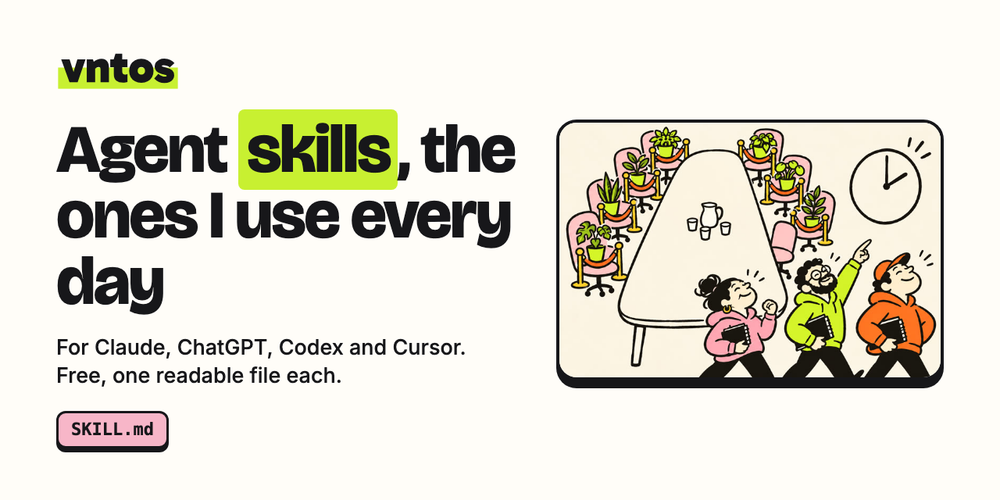

<p align="center"></p>

# Agent skills for Claude, ChatGPT, Codex and Cursor

A skill is a set of instructions your AI follows for one job. These are the ones I run my own work on at [VNTOS](https://vntos.io), cleaned up so you can use them. They're free to use and change.

Each skill is one plain file, `SKILL.md`, written to the open [Agent Skills](https://agentskills.io) standard, so the same file works in Claude, ChatGPT, Codex, Cursor, Gemini CLI and the other tools that read it. There are no scripts and no code that runs on your computer. Read it before you add it. A check runs on every change to keep it that way ([what it checks](scripts/check.sh)).

## The skills

| Skill | What it does |
|---|---|
| [Meeting prep](skills/meeting-prep/SKILL.md) | Reads your last emails with the person and what's changed for them, then gives you a one-minute card: what you want, what they want, what you can give them, your questions and a 3-sentence opener. |

A follow-up tracker, meeting notes and a writing check are next. Each one gets a page on [vntos.io](https://vntos.io/resources?type=skill) with a sample of what you get.

## Add a skill

### Claude (the app)

1. Download the zip from the skill's page on [vntos.io](https://vntos.io/resources/skills/meeting-prep), or from the [latest release](https://github.com/vntos-io/agent-skills/releases/latest) here. Don't unzip it.
2. In Claude, go to Customize, then Skills.
3. Click +, then Create skill, then Upload a skill, and pick the zip.

If you don't see Skills, turn on code execution first under Settings, then Capabilities. It works on every plan, free included.

### Claude Code

```bash
claude plugin marketplace add vntos-io/agent-skills
claude plugin install meeting-prep@vntos
```

Then start a new session, or run `/reload-plugins` in one that's already open. Type `/meeting-prep`, or just ask for prep.

### ChatGPT

Skills are in ChatGPT Business, Enterprise and Edu workspaces ([OpenAI's guide](https://help.openai.com/en/articles/20001066-skills-in-chatgpt)).

1. Download the zip, as above.
2. In ChatGPT, open Plugins in the sidebar, then the Skills tab.
3. Click Create, then Upload from your computer, and pick the zip.

On Enterprise and Edu, an admin may need to turn on skill uploading first.

### Codex, Cursor, Gemini CLI and others

These all read skills from `~/.agents/skills/`. Put the skill's folder there:

```bash
mkdir -p ~/.agents/skills
git clone --depth 1 https://github.com/vntos-io/agent-skills.git /tmp/vntos-skills
cp -R /tmp/vntos-skills/skills/meeting-prep ~/.agents/skills/
```

Or use the [skills CLI](https://skills.sh), which knows where each tool looks:

```bash
npx skills add vntos-io/agent-skills --skill meeting-prep -g
```

Gemini CLI can also install it directly: `gemini skills install https://github.com/vntos-io/agent-skills.git --path skills/meeting-prep`.

Restart the tool, then ask for prep.

## Updates

I keep changing these as I use them, and every change is written down in the [changelog](CHANGELOG.md). A skill keeps its name and its job. If one starts working noticeably differently, its version number jumps from 1.x to 2.0.

- In Claude Code, run `claude plugin update meeting-prep@vntos`, or turn on auto-update for the vntos marketplace under Marketplaces in `/plugin`.
- In the Claude or ChatGPT app, download the zip again and upload it over the old one.
- Anywhere else, copy the folder again, or run `npx skills update`.
- To hear about it, click Watch at the top of this page, then Custom, then Releases. GitHub emails you when a new version is out.

## Questions and problems

Open an [issue](https://github.com/vntos-io/agent-skills/issues/new/choose) if something doesn't work or you have an idea for a skill. I don't take pull requests, since I test every change on my own work first, but ideas in an issue are welcome. For anything security related, see [SECURITY.md](SECURITY.md).

## Want help with more than a skill?

VNTOS builds software and AI tools for small and mid-size companies. If you want your AI set up for how your team works, [book a call](https://vntos.io/start).

## License

[MIT](LICENSE). Use them, change them and share them.
